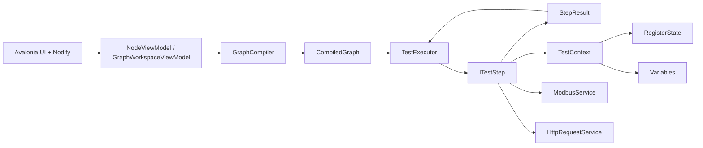

---
tags:
  - testbuilder
  - obsidian
  - documentation
updated: 2026-11-18
---

## Быстрая настройка сети — 2026-11-18

В исходники добавлены кнопки наборов для четырёх 100-Мбитных, четырёх
гигабитных и восьми 100-Мбитных + двух гигабитных портов; свои наборы
сохраняются и переносятся JSON. «Проверить связь» проверяет выбранные пары
короткими пакетами в обе стороны, отдельно от полного DataTest.
101 целевой тест на macOS и 102 на APK-03-07 прошли; аппаратная проба
`.2 ↔ .6` получила все 247 пакетов каждого направления. В лаунчере функция
ещё не опубликована; рабочие профили компьютера сохранены побайтно.
См. [[03 - Работа с приложением]] и [[10 - Настройки логирование тесты]].

## Прямое соединение карт — 2026-11-18

[[50 - Прямое соединение карт APK-03-07 2026-11-18]]: обнаружено несовпадение
кабельных пар диагностического профиля с реальными соединениями; `.8/.9`
не подключены. Исправлены только пары пользовательского диагностического JSON.
Три штатных прогона 100/1000 Мбит/с прошли без потерь: 30 направлений,
TX=RX=3413520. Отказ короткого
гигабитного прогрева прежней beta воспроизведён без DUT и прошёл после повтора.
Дополнительный четвёртый прогон записан отдельным процессом в два pcap:
пакеты и номера `.2 ↔ .6` на 100/1000 Мбит/с совпали с журналом приложения.
Первые три прогона не имели сохранённого отдельного сетевого захвата.

## Единая поставка — 2026-11-18

[[49 - Единая поставка через лаунчер]]: общий выпуск для всех рабочих мест,
проверка компонентов в «Сеть», локальные привязки оборудования отдельно от
сборки. Отдельные DLL на компьютерах не являются релизом.

## MAC-обучение DataTest — 2026-11-17

[[48 - MAC-обучение и драйвер APK-03-06 2026-11-17]]: полный неизменённый
профиль от 17.11 прошёл на APK-03-06 в 00:00–00:11 18.11, DLL `a3d8502`.
Все 10 направлений: TX=RX, всего 1137840 пакетов, потери и ошибки 0.
Медь — 99,285–99,443 Мбит/с, SFP — 987,557 и 993,049 Мбит/с.
АКБ/UPS, MAC после перезапуска и отчёт на 3200619 прошли; четыре этикетки
приняты очередью принтера. Все 15 профилей сохранены побайтно.
353 целевых теста DataTest/UI и 135 Modbus/cleanup прошли; группы пересекаются.
Исправлены подготовка MAC, общий старт отправителей, роль короткого прогрева
и ожидание состояния Modbus. Realtek/Npcap обновлены. Серверная beta остаётся
с маркером 14; аппаратно проверена локальная DLL в прежней папке приложения.

## Сбой APK-03-06 после обновления — 2026-11-17

[[47 - Сбой гигабитного прогрева APK-03-06 2026-11-17]]: маркер 14 и
профиль от 17.11 подтверждены. Все 100-Мбитные пары и гигабит `.3 → .2`
прошли без потерь. `.2 → .3` остановлен TB1503 на прогреве: два отправителя
дали 950–958 Мбит/с при пороге 980. На ПК WinPcap 4.1.3; метаданные Realtek противоречивы. Проверка
фактического драйвера и причинные контроли описаны в заметке 48.
Осмотр выполнен без изменения системы и профилей. Второй ПК offline;
его успешные прогоны сообщены пользователем.

## Beta с DataTest и профилем от 17.11.26

[[46 - Публикация DataTest и профиля 17.11.26]]: маркер **14**,
исходники `1614302`, 760 файлов проверены на Windows и сервере.
46 обязательных тестов прошли. Добавлен пользовательский профиль UPS 8x2Pro
от 17.11.26: изменены только две строки с датой, остальной файл побайтно
сохранён. Все 14 прежних серверных профилей неизменны, всего их 15.
Резервная копия 758 файлов проверена. Полный прогон пользователь выполняет сама.

## 100 Мбит/с и готовность стенда — 2026-11-17

[[45 - Исправление 100 Мбит и проверка двух стендов 2026-11-17]]:
в Windows до 100 Мбит/с введена покадровая отправка по QPC с выбором
одного/двух отправителей. Блокирующие циклы захвата, подготовки и передачи
работают на выделенных потоках. 344 теста прошли. Финальная аппаратная
матрица APK-04-04 после 3 мин 15 с загрузки: четыре пары 100 Мбит/с и
гигабитная пара прошли в обе стороны, все 1137840 проб получены.
APK-03-06 проверен нативными пробами со старым WinPcap. Профили сохранены,
На момент аппаратных проб новая beta ещё не публиковалась;
последующая публикация — [[46 - Публикация DataTest и профиля 17.11.26]].


## Проверка двух стендов — 2026-11-17

[[44 - Аппаратная диагностика DataTest 2026-11-17]]: на APK-04-04 с согласия
пользователя обновлены два драйвера Realtek; новая нода с двумя отправителями
прошла три двусторонних гигабитных замера (994–998 Мбит/с, без потерь).
На APK-03-06 выявлено ложное отклонение по RX отправителя; код исправлен.
336 тестов прошли. На APK-04-04 остаётся отдельный вопрос замедления
100-Мбитного генератора, воспроизводимый и прежней DLL. Полный граф и
новая публикация не выполнялись, эталонный JSON сохранён.


## Гигабитное исправление опубликовано — 2026-11-17

[[43 - Публикация гигабитного исправления 2026-11-17]]: beta, маркер 13,
исходники f6ba77e. 756 файлов проверены; 14 JSON профилей неизменны.
290 целевых и 45 обязательных тестов прошли. Резервная копия проверена.
Аппаратный результат ожидается.


## Гигабитный генератор — 2026-11-17

[[42 - Гигабитный генератор 2026-11-17]]: при полной скорости линка выше
100 Мбит/с короткие очереди 2 мс без повторной синхронизации каждого кадра;
контроль скорости/потерь сохранён, 100-Мбитный режим прежний. 290 тестов
прошли, аппаратный результат ожидается. Эталонный профиль менять запрещено.


# TFortisTestBuilder

## 2026-11-17 — beta опубликована

[[41 - Публикация beta 2026-11-17]]: исходники 8a6f986, маркер 12,
754 проверенных файла, 14 профилей. Резервная копия проверена.


## 2026-11-16 — новизна и ручная актуальность профилей

[[40 - Новые и актуальные профили]] — автоматическая плашка переименована
в **Новый** и отражает дату отдельно для каждого изделия. **Актуальный**
теперь ставится/снимается человеком через ПКМ в редакторе и пульте, без
ограничения количества. Отметки хранятся локально вне JSON; отмеченные и
новый профиль видны в свёрнутой группе. Это уточняет выбор профилей из
предыдущей правки, сохраняя отдельную подпись диагностических методик.

## 2026-11-16 — исправления после сбоев на нескольких ПК

[[39 - Исправления для нескольких стендов 2026-11-16]] — разделены назначения
производственных и диагностических профилей; исправлен порядок печати/отчёта
в десяти примерах, добавлена проверка до запуска. DataTest использует
синхронизированные очереди и проверяет отправитель на прогреве. Есть ранняя
проверка сетевых привязок, диагностика NIC и контрольные суммы запуска.
Для 1420/1421 EL60v5 разрешён ограниченный повтор установки состояния через
карту оборудования. Алгоритмы и параллельность четырёх базовых графов сохранены.
Аппаратный прогон и серверная публикация ещё не выполнены.

## 2026-11-16 — сбои на нескольких стендах

[[38 - Разбор сбоев нескольких стендов 2026-11-16]] — производственный эталон
PSW+UPS-Box 8x2Pro остаётся **«Параллельная проверка с SFP · 11.11.26»**.
Диагностический 13.11 не записывает MAC, но из-за выбора по дате получает
плашку «Актуальный». В нём также отчёт предшествует необязательной печати.
Три приложенных журнала относятся к 11.11: недосыл генератора SFP, потери
на медных парах и неподтверждённая запись 1421. Пары IP отличаются от поставки.
Причины уровня драйвера/железа ещё требуют проверки на соответствующих ПК;
код, профили и сервер в расследовании не менялись. 57 целевых тестов прошли.

## 2026-11-13 — beta опубликована с четырнадцатью профилями

[[37 - Публикация beta с 14 профилями 2026-11-13]] — `1.0.2-beta`, исходники
`f7e1549`, маркер **11**. На сервере проверены 749 файлов, четыре базовых и
десять диагностических профилей в `profiles`, включая Ex/Box 2G8F.
Проверенная резервная копия — 737 файлов. Windows-проверка: 0 ошибок,
2 замечания рабочего места. Клиентский и аппаратный прогоны не выполнялись.
После публикации пользователь сообщила, что beta пока работает нормально;
обратная связь записана в [[17 - Журнал проверок]] (VER-082).

## 2026-11-13 — перенос карточки изделия вместе с профилем

JSON новых сохранений и копий содержит резервную карточку `catalogModel`,
связанную с `deviceModelId`. Импорт добавляет новую карточку в местный каталог,
при конфликте предлагает явный выбор. ПКМ → **Экспорт профиля** также фиксирует
макеты этикеток в передаваемом JSON. **Ещё → Зависимости профиля** показывает
карточку, внешние файлы и местные параметры печати. См. [[06 - JSON профили]]
и [[33 - Добавление коммутатора и платы]].

## 2026-11-13 — смена модели и отметки проверки

Копия профиля после выбора другого изделия получает параметры номера, MAC и
этикетки из справочника. Зависимые от методики ноды помечаются жёлтым;
обычные — голубые, ветви отказа — красные. Отметки сохраняются до подтверждения
и поддерживают отмену. Связи и размещение сохраняются. Описание:
[[03 - Работа с приложением]], формат: [[06 - JSON профили]].

## 2026-11-13 — набор для проверки десяти моделей

[[36 - Десять диагностических профилей 2026-11-13]] — отдельная папка
примеров с десятью профилями, переносимым справочником, проверками серийных
номеров/отчётов и инструкцией ручной приёмки. Четыре базовых профиля сохранены.
При отказе отчёт теперь сохраняет подробную причину и при выбранной
неуспешной булевой строке. Windows и аппаратный прогон требуют АПК‑03.

## 2026-11-11 — обновление beta опубликовано

[[35 - Публикация beta с профилями 11.11.26]] — исходники `5d1630c`, маркер 10.
На сервере проверены 735 файлов и четыре базовых профиля в `profiles`;
названия, даты JSON и даты файлов — 11.11.26. Резервная копия 728 файлов
сохранена и проверена на Вышенской.

## 2026-11-11 — комплект подготовлен к публикации

[[34 - Подготовка beta 2026-11-11]] — master в GitHub обновлён до `2e849ed`.
Подготовлен проверенный Windows x64 ZIP `1.0.2-beta` с четырьмя профилями.
Результат содержит 734 файла по манифесту; серверная активация ещё не выполнялась.

[[33 - Добавление коммутатора и платы]] — инструкция по регистрации модели,
созданию профиля, настройке серийных номеров, отчётов и этикеток.

## Повторяемая сборка и публикация

[[28 - Сборка и публикация обновления]] — инструкция для нового диалога:
исходники, Windows ZIP, перенос через Вышенскую, резервная копия, публикация,
маркер лаунчера, восстановление и проверка результата. Команда skill:
`$tfortis-release`. В заметке есть готовые запросы для обоих режимов.

## 2026-11-10 — beta с составом отчёта 8x2Pro

[[32 - Beta с отчётом 8x2Pro 2026-11-10]] — маркер 9. Профиль «параллельный
старт · с проверкой SFP · отчёт 10.11» сохраняет связи выпуска 09.11
и выбирает 50 строк из образца отчёта.

## 2026-11-09 — опубликована 1.0.2-beta

[[31 - Доставка профилей beta 2026-11-09]] — предыдущая сборка из `9be51c9`
опубликована в 17:15, проверены 725 файлов, маркер лаунчера 8. Четыре профиля
с подписью «09.11» добавляются рядом с рабочими, даже если путь к стандартной
папке сохранён в настройках. Доставка в эту папку проверена на Windows.
Резервная копия маркера 7 сохранена на Вышенской.

## 2026-11-02 — выпуск, сервер и диагностика АПК03

[[26 - Выпуск и диагностика 2026-11-02]] — полная сводка дня: архивы `.1/.2/.3`,
загрузка `.2` в `\\test.ft.local\deviceTestWeb\Launcher_Beta\TFortis_Stand_Builder`,
резервная копия на Вышенской, маркер лаунчера, исправления COM/журнала/аргументов,
selftest и DataTest, проверки и dev-обновления АПК03. Поздние исправления были
установлены в dev; повторная публикация серверной beta ими не подтверждена.
На 2 ноября начатая отдельно `1.0.2-beta` ещё не была выпущена; публикации
9 ноября описаны в [[27 - Публикация 1.0.2-beta 2026-11-09]] и [[29 - Повторная публикация 1.0.2-beta 2026-11-09]].

## 2026-10-14 — платы SW/PoE

В основной ветке реализован перенос TFortisBoard: конфигурируемое оборудование
Modbus RTU в JSON, фильтр плат/коммутаторов, редактор изображения и областей,
консоль, внешние программы, разбор ответа, цвет LED и повторы For на одном slave.
Подробности — [[25 - Перенос TFortisBoard в TestBuilder]].
Офлайн-руководство открывается из «Настройки → Полная инструкция»;
исходник — `TestBuilder/Assets/Help/user-guide.json`: 56 статей с поиском,
пошаговыми действиями, справкой по нодам и экспортом для печати.
С 2026-10-19 параметры двух профилей перенесены из предоставленных RTL_SW_v1
и RTL_POE_v1; аппаратное подтверждение исправления К5 пока отсутствует.

Первый запуск предлагает интерактивное обучение; повтор — через настройки.
Учебное окно проводит через пульт, сохранение копии и создание связанного графа,
с отдельными временными профилями без доступа к оборудованию. См. [[03 - Работа с приложением]].


TFortisTestBuilder - desktop-приложение на .NET 8 и Avalonia для визуальной сборки и запуска производственных тестов оборудования. Пользователь собирает сценарий как граф нод, подключается к стенду по COM/Modbus RTU, запускает граф, а приложение выполняет Modbus-операции, HTTP-запросы, сетевые проверки, операторские действия, печать этикеток и отправку отчета. Независимые проверки можно запускать параллельно через ветвление графа.

Главная идея проекта: визуальная нода в редакторе не исполняется сама по себе. Она хранит параметры и коннекторы, затем компилируется в `TestNode`, внутри которого лежит runtime-шаг `ITestStep`. Шаг возвращает `StepResult`, а исполнитель выбирает следующий переход: `Next`, `True`, `False` или `Stop`.

Термины стенда: **старые коммутаторы** — модели без `Pro`, **новые** — модели
с `Pro`. Первой в TestBuilder добавили новую модель `PSW+UPS-Box 8x2Pro`;
`PSW-2G6F+` относится к старым. Их профили используют разные страницы
selftest и способы записи MAC, поэтому параметры нод нельзя переносить между
ними без проверки модели. См. [[06 - JSON профили]] и [[12 - Глоссарий]].

## Актуальное состояние

Сверка текущей документации с кодом выполнена 2026-10-28. Область и ограничения — [[13 - Карта актуальности]]. В текущем `TestBuilder.slnx` подключены только два проекта:

- `TestBuilder/TestBuilder.csproj`;
- `TestBuilder.Tests/TestBuilder.Tests.csproj`.

Демонстрационные проекты Nodify `Nodify.Calculator` и `Nodify.StateMachine` удалены из рабочей копии и не являются частью решения. Локальная папка `nodify-avalonia-avalonia_port` остается только как сторонние исходники/справочный код; само приложение использует NuGet-пакет `NodifyAvalonia` версии `6.6.0`.

## Тестирование по моделям

- [[20 - PSW-2G6F+ тестирование]] — старый PSW: `/test.shtml`, веб-прошивка,
  Sensor1, 12 линий PoE, UDP MAC и четыре пары DataTest.
- [[21 - PSW+UPS-Box 8x2Pro тестирование]] — новый Pro: LuCI selftest,
  UPS, нагреватели, WinSCP MAC и варианты DataTest с SFP/без SFP;
  ограничения датчиков и реле указаны в самой заметке.

## Карта документации

- [[31 - Доставка профилей beta 2026-11-09]] — текущая beta, маркер 8, автоматическое добавление четырёх профилей и проверенная копия.
- [[30 - Публикация 1.0.2-beta с обновлением 8x2Pro 2026-11-09]] — предыдущая beta, маркер 7, новый 8x2Pro и проверенная копия.
- [[29 - Повторная публикация 1.0.2-beta 2026-11-09]] — предыдущая сборка из `8560734`, маркер 6, проверки и резервная копия.
- [[28 - Сборка и публикация обновления]] — повторяемая процедура выпуска и публикации, вход для skill `tfortis-release`.
- [[27 - Публикация 1.0.2-beta 2026-11-09]] — опубликованная версия, резервная копия, контрольные суммы, профили и границы проверки.
- [[26 - Выпуск и диагностика 2026-11-02]] — версии и места установки, загрузка на сервер, резервная копия, пути, коммиты и результаты проверок за день.
- [[25 - Перенос TFortisBoard в TestBuilder]] — согласование переноса SW/PoE: комментарии к плану, исключение XGPro/FTServiceUtils и отказ от физического RUN; параметры оригинальных профилей перенесены.
- [[24 - Инструкция для первого знакомства]] — инструкция для пользователей: первый запуск, готовая проверка, новый профиль и фактические ограничения программы и Pro-профиля.
- [[01 - Быстрый старт]] - как собрать, запустить, настроить папку профилей и начать тест.
- [[02 - Архитектура проекта]] - слои приложения, зависимости, основные классы и жизненный цикл.
- [[03 - Работа с приложением]] - вкладки, редактор графа, палитра, профили, логи, горячие клавиши.
- [[04 - Графы и выполнение]] - компиляция, переходы, вложенные графы, контекст, пауза, остановка, ошибки.
- [[05 - Справочник нод]] - детальное описание каждой ноды, ее параметров, выходов, JSON-полей и runtime-поведения.
- [[06 - JSON профили]] - формат сохранения графов, совместимость типов и вложенные `body`/`bodyGraph`.
- [[07 - Modbus и мониторинг]] - подключение, сканирование slave, `RegisterState`, авто-восстановление связи.
- [[08 - Модели устройств и регистры]] - поддерживаемые типы устройств и карты регистров.
- [[09 - HTTP сеть отчеты печать]] - HTTP-клиент, selftest, запись MAC серии Pro, DataTest, отчеты и печать серийных этикеток TSC/EPL.
- [[10 - Настройки логирование тесты]] - настройки приложения, UI-логгер, тестовый проект и покрытие.
- [[11 - Расширение проекта]] - как добавить новую ноду, новый шаг, JSON-поля и тесты.
- [[12 - Глоссарий]] - термины проекта.
- [[13 - Карта актуальности]] - сверка заметок с текущей структурой кода и список покрытых областей.
- [[14 - Реестр решений]] - принятые архитектурные, UX- и compatibility-решения.
- [[15 - Backlog и пожелания]] - кандидаты будущих работ, приоритеты и критерии готовности.
- [[16 - Статус проекта]] - оценка продуктовой готовности, вехи и риски.
- [[17 - Журнал проверок]] - результаты сборок, тестов, ручных и стендовых проверок.
- [[18 - Selftest и загрузка DUT]] - подтвержденный стендом алгоритм ожидания selftest и разбор предыдущих нерабочих подходов.
- [[19 - Поля тестовой страницы DUT]] - полный словарь selftest-полей, их смысл, индексация, типы, aliases и правило подсчета.
- [[20 - PSW-2G6F+ тестирование]] - последовательность теста старого коммутатора, прошивка и Sensor1.
- [[21 - PSW+UPS-Box 8x2Pro тестирование]] - последовательность теста нового коммутатора Pro.

- [[22 - Инцидент сетевых карт 2026-09-28]] — разбор сбоя DataTest на APK-03-07: питание, привязка карт, захват и гигабитный генератор.
- [[23 - Параллельное выполнение проверок]] — параллелизм через несколько связей одного выхода, автоматическое объединение, ограничения ресурсов и отдельный Pro-профиль с параллельным стартом.

## Где лежит код

```text
TestBuilder/
  Domain/
    Execution/      Исполнитель графа, TestNode, TestContext, StepResult
    Steps/          Runtime-логика нод
    Modbus/         Сканирование slave и модели устройств
    Monitoring/     RegisterState и фоновый мониторинг регистров
  Services/
    GraphCompiler.cs
    GraphSerializer.cs
    Modbus/
    Http/
    Logging/
  ViewModels/
    Graphs/
    NodifyVM/
    StepVM/
  Views/
    TestViews/
TestBuilder.Tests/
  StepTests/
  SerializationTests/
  MonitoringTests/
docs/
  profile_zero_completed.json
  PSW_UPS_Box_8x2Pro_test_graph.md
profiles/
  Четыре стандартных профиля релиза
reference/
  Шаблоны плат, карты Modbus и справочник серийных номеров
examples/profiles/
  manual_label_printing.json                       Импортируемый пример ручной печати
```

## Самые важные понятия

| Понятие | Что означает |
|---|---|
| `NodeViewModel` | Визуальная нода в редакторе Nodify: заголовок, позиция, коннекторы, параметры UI. |
| `ITestStep` | Исполняемый атомарный шаг теста. |
| `TestNode` | Узел runtime-графа, содержит `Step`, `Next`, `OnTrue`, `OnFalse`. |
| `GraphCompiler` | Преобразует `GraphWorkspaceViewModel` в `CompiledGraph`. |
| `TestExecutor` | Выполняет `TestNode` по результатам `StepResult`. |
| `TestContext` | Общий контекст запуска: регистры, переменные, текущий slave, observer, операторский prompt. |
| `RegisterState` | Потокобезопасное хранилище последних известных значений регистров. |
| `GraphSerializer` | Сохраняет и загружает графы в JSON-профили. |
| `For Slaves` | Составная нода, выполняющая вложенный граф для диапазона Modbus slave ID. |
| `Subtest` | Составная нода для логического подтеста с собственным вложенным графом. |

## Быстрая схема



## Текущий функциональный охват

Проект уже реализует:

- визуальный редактор графа на NodifyAvalonia;
- палитру нод с категориями;
- сохранение и загрузку JSON-профилей;
- вложенные графы для `Subtest` и `For Slaves`;
- параллельные ветви через обычные связи графа с автоматическим ожиданием всех ветвей в общей следующей ноде;
- undo/redo для базовых операций графа;
- запуск, паузу, продолжение и остановку теста;
- подсветку текущей и ошибочной ноды;
- подключение к Modbus RTU стенду через COM;
- проверку состава оборудования выбранного профиля на открытом COM-порту;
- фоновый мониторинг регистров;
- авто-восстановление Modbus-соединения при критических ошибках;
- HTTP selftest и API-запросы к DUT/серверу;
- вычисление MAC из серийного номера;
- запись MAC коммутаторов Pro через `set_mac_pro.bat` и поставляемый portable WinSCP;
- программный DataTest через SharpPcap/Npcap;
- сбор и отправку построчного отчета в формате `QTstand_old`;
- печать четырех этикеток TSC TE310 с полным серийным номером;
- вкладку «Этикетки» для ручной печати и повторной печати;
- настраиваемые кнопки профиля с отдельными графами и переключателями;
- верхнюю сворачиваемую панель регистров с масштабом карточек 50–150%;
- настраиваемую панель ICMP-пинга справа от логов и, по выбору, в пульте;
- редактор сетевого плана и пар DataTest;
- автосохранение расположения панелей и фильтра изделий;
- отправку отчета на сервер и локальную копию;
- набор unit-тестов для ключевых шагов.

На уровне палитры сейчас доступно 30 нод в 6 категориях. Еще 2 технические ноды (`Body Start`, `Body End`) создаются внутри тела `For Slaves` и не добавляются из общей палитры. Неиспользуемые `Check Register Equality`, `Poll Register` и три специализированные legacy-ноды UPS/IRP удалены из проекта; старые профили с ними отклоняются с подсказкой замены. Датчики проверяются обычными `Write Register` и `Wait Variable Until`; отдельная нода IO-2 удалена. В PSW-2G6F+ проверяется только сухой контакт Sensor1, в профиле Pro — Sensor1/Sensor2.

## Важные ограничения

- Ноды проверки регистров (`Проверка диапазона`, `Ожидание значения`) по умолчанию читают последнее значение из `RegisterState`. При `LiveRead=true` они читают Modbus напрямую; `Проверка диапазона` дополнительно поддерживает повторные чтения с паузой.
- `ModbusWriteStep` пишет напрямую через `IModbusService`; при включенной проверке записи он дополнительно читает регистр и обновляет `RegisterState`.
- `For Slaves` обходит арифметический диапазон slave ID либо повторяет тело на текущем slave (`RepeatOnSameSlave`). Для произвольного списка адресов нужны несколько циклов или отдельные ноды.
- `WaitVariableUntil` умеет как опрашивать произвольный endpoint в `HttpGet`, так и заново снимать всю тестовую страницу в `SelftestSnapshot`; старые специализированные poll actions удалены.
- RAW-печать в `PrintLabel` работает только на Windows, потому что использует `winspool.drv`.
- `Build Test Report` возвращает `False`, если в настройках нет `Stand ID`
  или в контексте нет полного положительного `SerialNumber`.
- У нод с флагом обработки ошибок снятая галочка продолжает обычный путь; непройденный пункт сохраняется в отчёте. Для selftest `FailOnError=false` теперь также даёт `True`.
