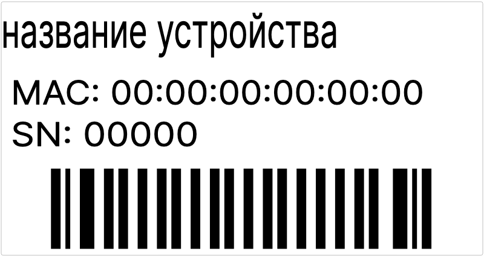
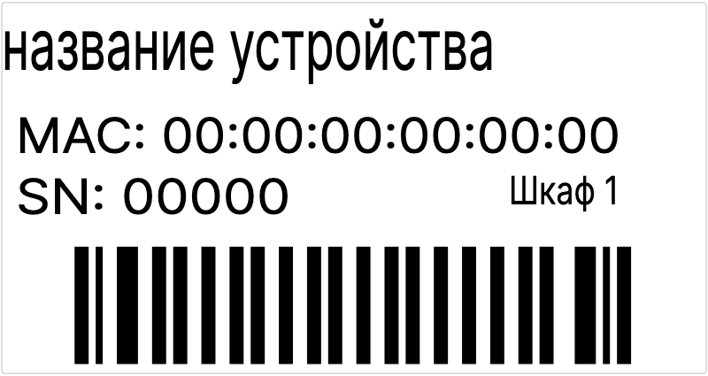

# Штатный макет по наброску — 24.11.2026

Для типов с названием обновлены и визуальный образец, и штатные ZPL-команды:

- Название у верхнего края: X0/Y0, высота36, максимальная ширина шрифта17.
- MAC: X6/Y44, высота25, ширина шрифта18.
- SN: X6/Y70, высота25, ширина шрифта20.
- Code 128: центр по X, Y104, высота50, модуль3.
- Вариант со шкафом: шкаф справа от SN на той же строке.

Координаты относительно начала этикетки, в точках принтера. Бумага300×158
при300dpi — 25,4×13,38мм. Восьмизначный код занимает237 точек, X31;
слева31 и справа32 точки. Минимум десять узких полос поля с каждой стороны
сохранён. Стандартный payload и SN остались `03200428` / `00428` для
полного номера3200428. Нейтральные данные образца и динамические подстановки
сохранены. Тип платы без названия не менялся.

«Макет по умолчанию» восстанавливает геометрию в черновике, сохраняя правила
формирования SN и штрихкода. До «Сохранить тип» местный файл не меняется;
«Отменить изменения» возвращает сохранённый вариант.

Точные предыдущие штатные команды добавлены в таблицу обновления. Сырые
штатные размеры/метрики обновляются только при совпадении с прежним дефолтом.
Собственные значения и визуальные Layout сохраняются. При отсутствующей
высоте корректно восстанавливается начало печати. Старые снимки используют
прежний бюджет шрифта: nullable NameFontMaxWidthDots / NameCharacterWidthFactor
оставляют метрику25/1, новые штатные шаблоны задают17/0.65. Поэтому точный
повтор не подхватывает новые шрифты или расположение.

Проверено:

- 148 тестов редактора/печати/форматирования/переноса/справки прошли.
- Отдельно прошли 46 обязательных проверок ProfileUiIntegrityTests,
  RussianInterfaceTests, DataTestModeTests и повторные 6 проверок справки.
  Итого194 различных теста; поиск и HTML-экспорт включают новую кнопку.
- Новый тест сравнивает X/Y/высоты/данные raw и визуального рендера,
  центрирование и поля, и строит PNG из LabelPreviewControl.
- Проверены возврат дефолта без записи файла, сохранение правил, миграция
  старых сырых stock-шаблонов, сохранение своих размеров и визуальной
  геометрии, повтор старого raw и чтение метаданных без высоты/начала печати.
- Встроенная справка описывает новый дефолт, кнопку, размеры, сохранение
  черновика и ограничения длинного кода.

Эталонные JSON-профили, сохранённые пользовательские шаблоны и серверная
поставка не заменялись. Рендер проверен на macOS; физическая проба на принтере
выполняется в Windows через «Пробная печать: 1 шт.».

