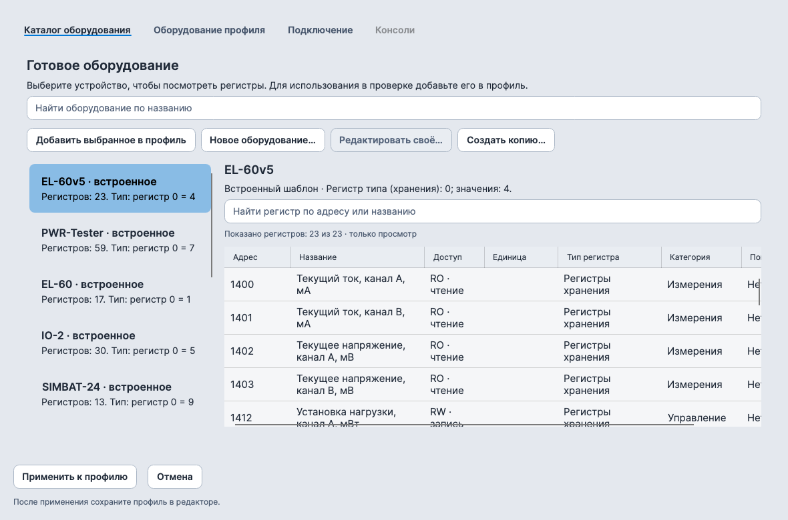
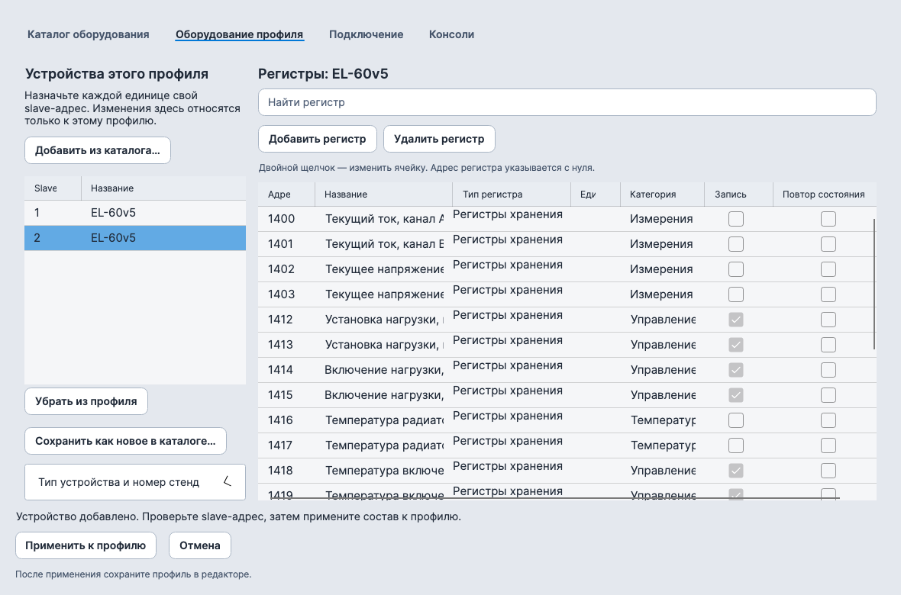
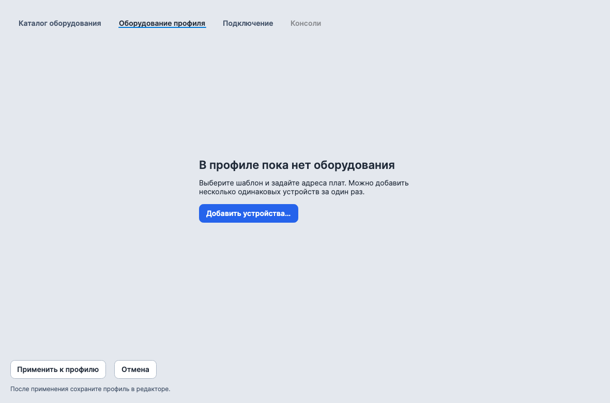
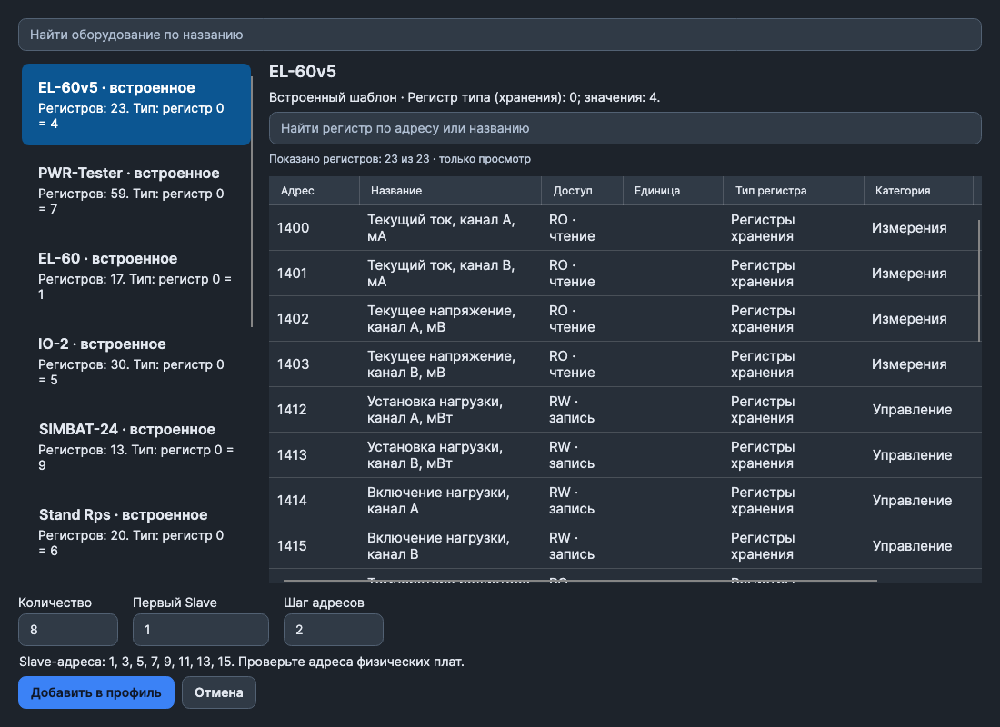
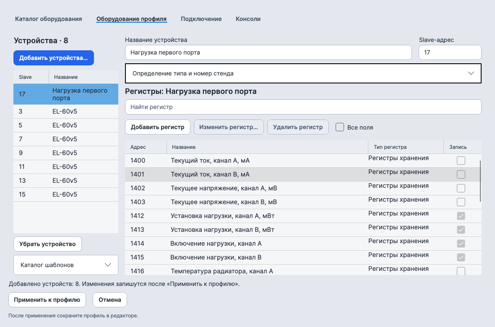
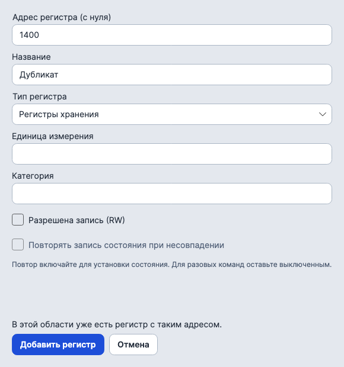

# Настройка оборудования: путь пользователя, 23.11.2026

Задача: собрать состав профиля с нуля, назначить адреса плат, проверить и
исправить карту регистров. Изменение выполнено в приложении Avalonia, в текущей
теме и системе компонентов проекта. Каталог и пользовательские профили не
перезаписывались; публикации на сервер нет.

## Что мешало

Исходный каталог позволял прочитать карту, но добавление повторных устройств
требовало отдельных действий. На вкладке состава постоянно отображались две
таблицы и кнопки удаления, даже когда устройств не было. Slave менялся внутри
ячейки, идентификация находилась внизу под списком. В узких колонках обрезались
названия и заголовки. Для изменения регистра требовалось знать про двойной
щелчок; все дополнительные поля занимали ширину постоянно.

Экраны исходного сценария зафиксированы перед изменением в этой проверке:

## Новый путь

1. **Открыть оборудование пустого профиля — проверено.** Стартовая вкладка —
   состав профиля. Пустое состояние показывает назначение и одно действие
   «Добавить устройства…». Неактуальные таблицы и действия скрыты.

   

2. **Выбрать шаблон и адреса — проверено.** Поиск и просмотр карты находятся
   в одном окне. Количество, первый Slave и шаг задаются до добавления; восемь
   плат на 1, 3, 5, 7, 9, 11, 13, 15 добавляются одним действием. Конфликты,
   неверные числа, выход за 247 и повтор источника номера стенда блокируются.
   Для каждой платы создаётся независимая полная копия.

   

3. **Указать имя и адрес выбранной платы — проверено.** Явные поля расположены
   над картой, идентификация рядом. В таблице оставлены четыре основных поля;
   «Все поля» возвращает остальные. Выделение регистра сохраняется при
   обновлении полей и возврате из формы. Неверный ввод нельзя потерять при
   переключении устройства; ошибочную строку можно удалить.

   

4. **Добавить или изменить регистр — проверено.** Отдельная форма содержит
   адрес, исходное название, область, единицу, категорию, запись и повтор.
   Дубликат адреса в области, пустое имя и некорректный адрес отклоняются.
   Input/Discrete не разрешают запись и повтор. Неизвестные JSON-поля
   существующего регистра сохраняются. Двойной щелчок в таблице остаётся
   дополнительным способом редактирования.

   

5. **Применить или отменить — проверено.** Применение переносит черновик в
   граф, после чего профиль сохраняется обычным способом. Отмена формы не
   добавляет строку, отмена выбора не добавляет платы, отмена главного окна
   оставляет исходный граф. Последнее удалённое устройство возвращает пустое
   состояние. Применение такого состава задаёт hardware=null.

## Проверка и границы

Новые сценарии запускаются через реальные контролы Avalonia в headless-окне:
мышь, поля, выбор, формы, Tab, сохранение и отмена. Снимки текущего прогона
просмотрены в обеих темах; отдельно проверено окно 1000×650. Поля получили
названия для автоматизации, у форм есть стандартные подтверждение/отмена.
Проверка экранным диктором и полная оценка доступности не выполнялись.
Применение проверено по закрытию окна и итоговым данным графа; отдельный
снимок родительского редактора после закрытия не делался. Обновлённое
приложение запущено на Маке.

Основные тесты: HardwareWorkflowTests, EquipmentLibraryTests,
FreshUserJourneyTests, UserGuideTests и обязательные ProfileUiIntegrityTests,
RussianInterfaceTests, DataTestModeTests. Встроенная инструкция описывает
новые кнопки, порядок действий и границы сохранения.

Общий прогон: 74 из 75 успешны; один профиль остановился при создании
GlyphTypeface Inter в headless на macOS. Оба SFP-профиля успешно повторены
отдельно; это ограничение тестовой среды не скрыто заменой шрифта приложения.
Итоговый целевой повтор: 15/15 (новый сценарий, каталог, справка и оба SFP).

Подключение реальных плат, Modbus-запись и аппаратная приёмка не входили в эту
проверку. Тесты используют временную библиотеку и профили; настройки рабочих
стендов, эталонные JSON, базовые карты и серверные файлы не менялись.
