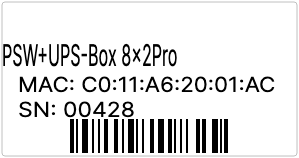

# Формат SN и содержимое штрихкода — 2026-11-24

Проверено на macOS, .NET 8, ветка master. Изменения собраны локально.
Публикация и изменение производственных профилей не выполнялись.

## Результат

- PSW+UPS-Box 8x2Pro: полный номер `3200428` → надпись `SN: 00428`, Code 128 `03200428`.
- PSW-2G6F+: полный номер `600428` → `SN: 00428`, код `00600428`.
- RTL-SW: `31300428` → текст `00428`, код `31300428`; RTL-POE: `31200428` → текст `00428`, код `31200428`.
- Для остальных моделей используются их код и серия. Полный номер остаётся в данных запуска и отчётах.
- Надпись и штрихкод имеют независимые правила: полный/короткий SN, разрядность, тип, служебный префикс, код комплектации, свои поля и постоянный текст. Явный `SerialTail:N` берёт последние N цифр.
- Обычная разрядность дополняет нулями; переполнение блокирует печать. Смена одного правила не меняет источник другого элемента. Номер чужой платы/серии не маскируется обрезанием.
- Открытие формы не меняет шаблон. Явное сохранение фиксирует показанные правила. Профильная копия сохраняется отдельно от общего каталога, перенос включает форматы.
- Узнаваемые старые штатные копии обновляются в памяти; пользовательские команды и явные правила сохраняются. Повтор старого теста печатает прежний снимок без миграции.

## Проверки

Расширенный прогон: **410/410**. Проверены модели и печать, перенос/адаптация профилей, получение производственного номера, повтор из последнего теста, справка и обязательные ProfileUiIntegrityTests, RussianInterfaceTests, DataTestModeTests.

После последней защиты номера другой платы: **231/231**. Повторно проверены LabelDataFormattingTests, LabelLayoutTests, LabelPreviewTests, PrintLabelStepTests, LabelPrintingTests, ReprintLabelActionTests, LastTestLabelTests, ProductionStepTests и UserGuideTests. Эти прогоны пересекаются; числа не суммируются как уникальные проверки. Сводка счётчиков — [checks.json](label-data-2026-11-24/checks.json).

Тесты интерфейса выполняют реальные изменения ComboBox/TextBox в светлой и тёмной теме, проверяют отсутствие записи общего файла при применении к ноде. Проверены стандартный EPL и визуальные элементы, сохранение/повтор собственных правил, невозможность рекурсивных форматов и отправки неподходящих данных принтеру. Для новых правил в JSON используется маркер `Print Label (data v1)`, который старые программы не исполняют как обычную печать.

Независимый ZXing декодирует полосы и весь PNG, отрисованный реальным LabelPreviewControl. Проверены новый `03200428`, прежний `003200428`, другие ведущие нули и текстовые данные Code 128. Цифровое изображение ниже — `03200428`.

[Форма в тёмной теме](label-data-2026-11-24/label-format-True.png), [в светлой теме](label-data-2026-11-24/label-format-False.png). В форме показан пример с изменёнными пользовательскими правилами.

## Производственная проба

Ведущий ноль является допустимыми данными Code 128: подмножество C кодирует пары цифр, включая `00`. Это следует из [описания команды Zebra ^BC](https://docs.zebra.com/us/en/printers/software/zpl-pg/c-zpl-zpl-commands/r-zpl-bc.html). Удалён именно дополнительный служебный префикс; ноль в коде типа `032` сохраняется. Причина отказа производственного сканера пока не установлена, модель сканера неизвестна.

Новый восьмизначный код занимает 158 точек при модуле 2 и 198 точек с тихими полями. В штатном ZPL он центрируется в X=562 на этикетке шириной 295 точек. Высота осталась 34 точки при 300 dpi (около 2,9 мм). Редактор позволяет увеличить высоту/модуль и проверить размещение, поля и результат считывания.

На Windows: открыть шаблон → «Редактор элементов…» → ввести реальный номер и MAC → проверить «Данные и проверка» → «Пробная печать: 1 шт.» → считать код в поле «Считанный сканером код (сравнить)». Ожидается точная строка `03200428`. При отсутствии считывания проверить размер, dpi, качество полос, свободные поля и настройки сканера. Считывание цифрового PNG не подтверждает качество физического отпечатка. Физическая печать и сканер этим прогоном не проверены.
