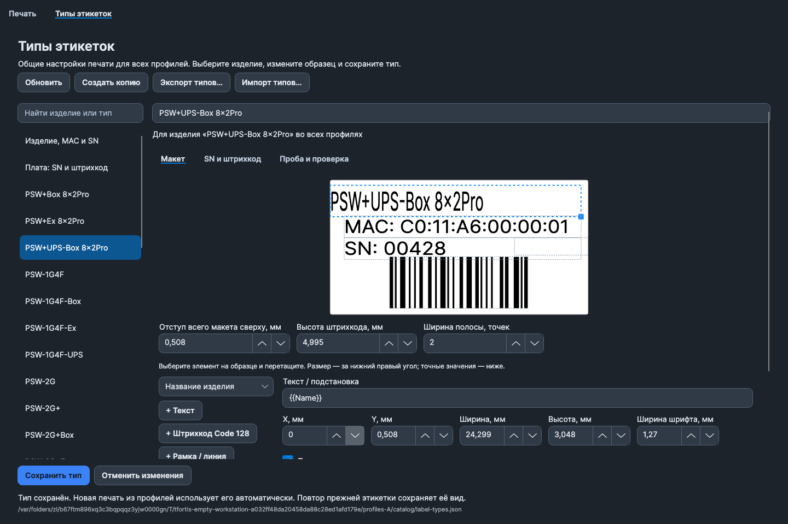
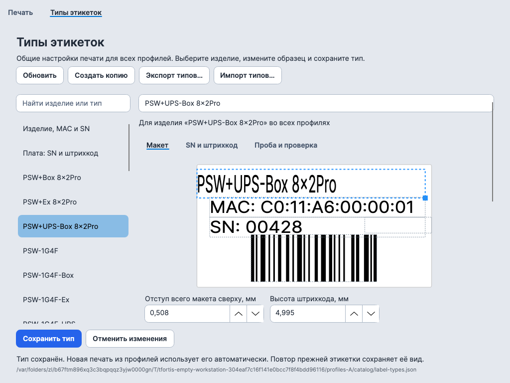

# Типы этикеток в основном интерфейсе — 24.11.2026

«Этикетки → Типы этикеток» содержит список изделий и общих типов, образец с
перетаскиванием, общий отступ сверху, высоту/модуль штрихкода, параметры бумаги,
сдвиг X, dpi, язык и яркость. Форматы SN/Code 128 и данные для пробы вынесены
в соседние вкладки этого же редактора. Дополнительных окон нет.

Тип изделия имеет приоритет над типом семейства и прежним макетом ноды.
Изменения действуют при новой печати из старых профилей без их перезаписи.
Серия, полный SN, код модели и MAC сохраняют прежний смысл. Повтор и история
используют точный снимок прежней этикетки. Неопределённому изделию общий тип
не присваивает код другой модели. Проба печатает текущий черновик один раз,
не сохраняет его и блокирует одновременный запуск проверки.

Данные: `catalog/label-types.json` выбранной папки профилей; поставка:
`reference/labels/types.json`, schemaVersion=1, types. Сохранение атомарное,
с .bak и защитой от чужой правки. Импорт создаёт черновики, которые сохраняются
по типам. Экспорт профиля включает эффективный макет в копию его ноды.
Прежние label-templates.json / templates.json остаются запасными источниками.

Проверено на macOS arm64, .NET 8:

- 142 теста связанных сценариев: LabelTypesTests, LabelDataFormattingTests,
  LabelLayoutTests, LabelPrintingTests, PrintLabelStepTests, LastTestLabelTests,
  ProfileCatalogTransferTests, UserGuideTests — все прошли.
- 46 обязательных проверок ProfileUiIntegrityTests, RussianInterfaceTests,
  DataTestModeTests — все прошли.
- Открытие/выбор типов не записывает настройки, каталог или JSON-профили.
  Черновики сохраняются при переключении; неверный числовой ввод, слишком
  широкий код и конфликт ревизии не заменяют сохранённый тип.
- Проверены RTL-SW/RTL-POE, приоритет общего/своего типа, сохранение модели в
  старой ноде без внешней карточки, повреждение файла, проба, точный повтор,
  перенос типов и экспорт производственного профиля без изменения исходника.
- Headless UI: тёмная тема 1440×960, светлая 1024×768; изменение отступа и
  высоты, сохранение и возврат между вкладками. OwnedWindows пуст.
- Справка: новая статья label-types, актуальные кнопки/приоритет/пути,
  поиск по разделу и HTML-экспорт. Встроенных статей — 84.

RAW-печать проверена через тестовый драйвер. Физическая бумажная проба и
считывание производственным сканером остаются проверкой на Windows-стенде.
Системные очереди принтеров и серверная поставка в этой работе не менялись.

