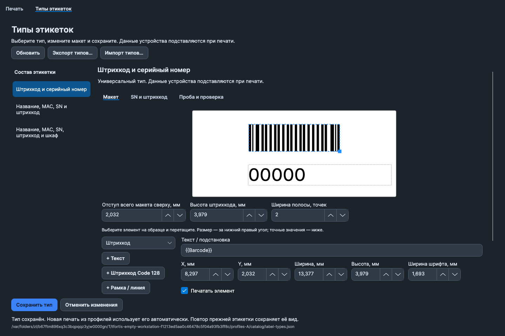
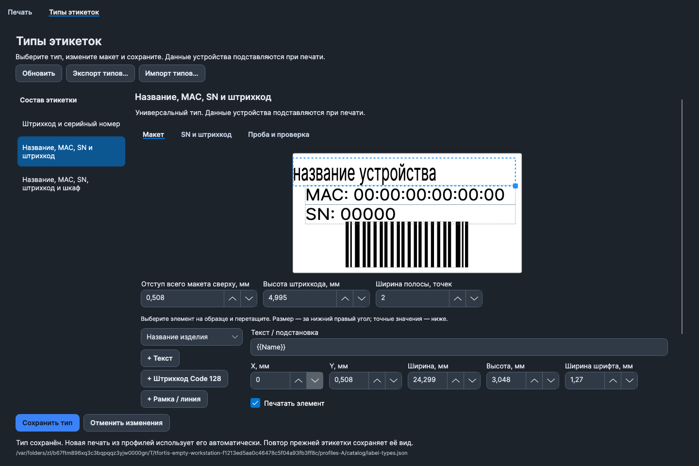
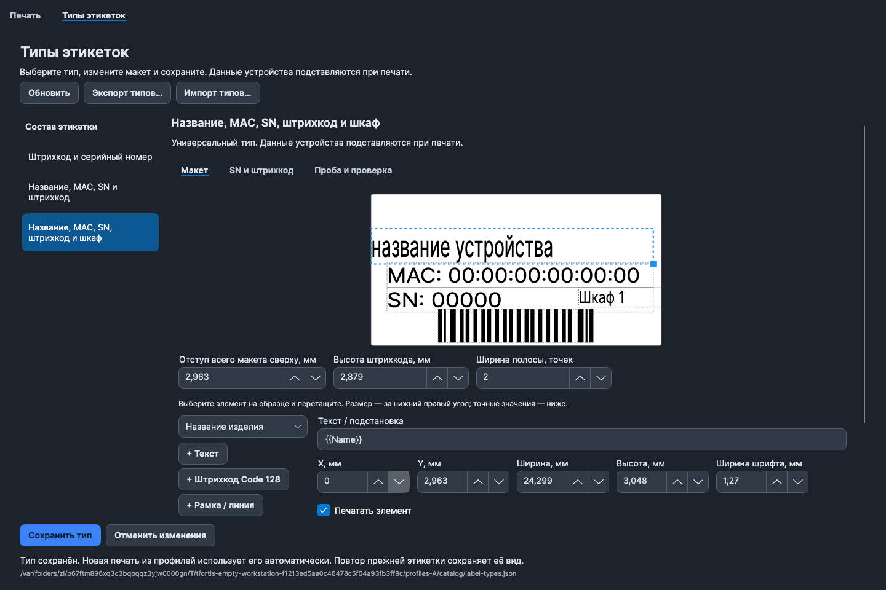

# Три универсальных типа этикеток — 24.11.2026

Редактор содержит три состава независимо от справочника изделий:

1. Штрихкод и серийный номер — два элемента.
2. Название, MAC, SN и штрихкод — четыре элемента.
3. Название, MAC, SN, штрихкод и шкаф — пять элементов.

В образцах: «название устройства», MAC `00:00:00:00:00:00`, SN `00000`,
Code 128 `00000000`, «Шкаф 1» у третьего состава. Элементы сохраняют
подстановки, а не буквальные значения образца. Так же выглядят три карточки
выбора в ручной печати. Редактор не создаёт строки моделей и отдельные копии.

Сохранённый универсальный тип применяется для подходящих моделей. Шкаф и
вариант берутся из карточки изделия. Макеты со шкафом и без него независимы.
Полный SN, настоящий тип, серия, MAC, название и шкаф сохраняются при рабочей
печати; повтор использует точный прежний снимок. Поиск короткого SN сохраняет
`MatchServerSerial` и смещение модели. Старые модельные записи остаются в
местном файле как запасные и не добавляют строк в интерфейс.

`catalog/label-types.json` и `reference/labels/types.json` сохраняют формат
schemaVersion=1. Добавлен общий ID `shared:device-cabinet`; прежние
`shared:board` и `shared:device` используются для первых двух составов.
Экспорт включает три универсальные записи и их черновики; импорт требует
проверки и сохранения нужных типов. Эталонные JSON-профили не менялись.

Проверки на macOS arm64, .NET 8:

- 145 тестов печати, общего редактора, форматов, старых шаблонов, переноса
  профилей и справки прошли. Проверены нулевые данные каждого состава,
  реальные подстановки, независимость шкафа, отсутствие модельных строк,
  приоритет сохранённого общего типа, перенос и повтор.
- 46 обязательных проверок ProfileUiIntegrityTests, RussianInterfaceTests и
  DataTestModeTests прошли отдельным прогоном: открытие интерфейса сохраняет
  параметры, вложенные графы и служебные ключи профилей.
- Headless UI: тёмная тема 1440×960, светлая 1024×768. Сняты все три состава,
  проверены редактирование/сохранение без дополнительных окон.
- Поиск, выбор раздела и HTML-экспорт встроенной инструкции проверены
  UserGuideTests; в статье label-types перечислены три состава и образцы.

Печать проверена через тестовый драйвер. Для проверки физического отпечатка
используйте «Пробная печать: 1 шт.» на Windows-стенде.

